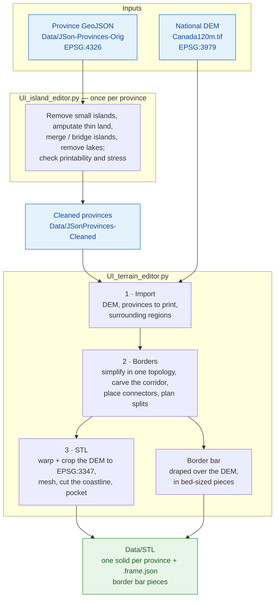

# 3D Terrain Project

Turn Canadian province boundaries (GeoJSON) and a national elevation model
(GeoTIFF) into STL files that print and fit together as a physical relief map.

The map prints as separate pieces:

- **one terrain solid per province**, with the real elevation on top, cut to the
  coastline;
- **a border bar** that runs along every border between provinces. Dovetail
  connectors on its underside drop into pockets cut into the bottom of the
  province pieces, which holds the map together.

Everything is built at one map scale (1:8,000,000 by default) and every setting
is given in printed millimetres.

**New here? Start with the [Usage Guide](docs/USAGE_GUIDE.md)**: the whole
workflow from province files to printable STLs, step by step.

## Processing Pipeline



**Process All** on the STL tab does the whole of stage 3 for every province and
the border bar in one run. Building terrain in QGIS with the DEMto3D plugin is
still possible as an alternative; see [USING_DEMTO3D.md](docs/USING_DEMTO3D.md).

## Installation

```powershell
py -3 -m venv .venv
.\.venv\Scripts\pip install -r requirements.txt
```

**Key dependencies:** `PySide6`, `geopandas`, `shapely`, `rasterio`, `trimesh`,
`manifold3d`, `numpy`, `scipy`, `matplotlib`, `vispy`, `topojson`.

The DEM is not in the repository (about 7 GB). Put it at
`Data/Canada120m-Orig/Canada120m.tif`, or a copy already reprojected to
EPSG:3347 at `Data/Canada120m-3347/Canada120m_3347.tif`.

## Tools

| Tool | What it is for |
|---|---|
| `UI_island_editor.py` | Clean up one province so it can be printed: **Remove Small**, **Amputate** (land narrower than the nozzle can lay down), **Merge**, **Bridge**, **Draw Bridge**, **Erase**, **Remove Lakes**, all with undo. A side panel scores the edits against the original and marks thin land and load-bearing necks at risk of breaking. |
| `UI_terrain_editor.py` | The whole terrain pipeline in three tabs: **Import** the DEM and regions, define the **Borders** (corridor, connectors, splits; hand-editable), and build the **STL**s, one province at a time or all at once with **Process All**. |
| `ScreenRuler.py` | Measure your monitor's real pixel size, once per monitor, so the island editor's **Real Size** shows a province at its printed size. |
| `harnesses/` | One small window per library, for checking that library on real geometry by itself. Developer tools; see [BUILDING_UI_HARNESSES.md](docs/BUILDING_UI_HARNESSES.md). |

```powershell
.\.venv\Scripts\python.exe UI_island_editor.py
.\.venv\Scripts\python.exe UI_terrain_editor.py
.\.venv\Scripts\python.exe ScreenRuler.py
```

Several libraries also run from the command line, for example
`python -m lib.LIB_geotiff_clip` ([USING_GEOTIFF_CLIP.md](docs/USING_GEOTIFF_CLIP.md)),
`python -m lib.LIB_raster_reproject` ([USING_RASTER_REPROJECT.md](docs/USING_RASTER_REPROJECT.md))
and `python -m lib.LIB_terrain_stl` ([USING_TERRAIN_STL.md](docs/USING_TERRAIN_STL.md)).

## Directory Structure

```
3D Terrain/
├── UI_island_editor.py                # Clean up one province for printing
├── UI_terrain_editor.py               # DEM + provinces → borders → STLs
├── ScreenRuler.py                     # Measure the screen, for Real Size
├── project_config.json                # The project's settings (tracked)
├── project_config.local.json          # This computer's changes (not tracked)
├── requirements.txt
├── Data/                              # Only JSon-Provinces-Orig is tracked
│   ├── JSon-Provinces-Orig/           # Province and US state GeoJSONs as downloaded
│   ├── JSonProvinces-Cleaned/         # Provinces saved by the island editor
│   ├── Canada120m-Orig/               # The national DEM (EPSG:3979)
│   ├── Canada120m-3347/               # The DEM reprojected to the print CRS
│   ├── Border/                        # Saved borders, connectors and splits
│   └── STL/                           # The STLs to print
├── docs/                              # Usage guide, tool guides, design notes
├── harnesses/                         # One inspection window per library
├── lib/                               # The libraries, imported as lib.LIB_*
│   ├── LIB_border_bar.py              # The border bar in its planned pieces: splits, build, colours
│   ├── LIB_border_connectors.py       # Dovetail connectors; border extrusion; province pockets
│   ├── LIB_border_plan.py             # The Borders stage as data: settings, Define, Save / Load
│   ├── LIB_border_regions.py          # Carve the border corridor out of the regions
│   ├── LIB_border_simplification.py   # Simplify every outline in one topology (TopoJSON)
│   ├── LIB_border_split.py            # Bed fit at any angle; split a border STL to the bed
│   ├── LIB_connector_rules.py         # The rules a connector is held to; moving, turning, sizing one
│   ├── LIB_geotiff_clip.py            # Clip a DEM to a province
│   ├── LIB_island_bridges.py          # Join islands with straight bridges of a set printed width
│   ├── LIB_island_bridging.py         # Draw land by hand with a brush
│   ├── LIB_island_erasing.py          # Erase land with a brush
│   ├── LIB_island_merging.py          # Merge islands with necks of land
│   ├── LIB_island_metrics.py          # Count land masses; how far apart they lie
│   ├── LIB_island_removal.py          # Drop islands below an area
│   ├── LIB_lake_removal.py            # Fill a province's lakes
│   ├── LIB_map_scale.py               # Printed mm ↔ ground km; scale bars
│   ├── LIB_print_all.py               # Every province and the border bar to STL in one run
│   ├── LIB_project_config.py          # The settings files, merged
│   ├── LIB_raster_plan.py             # Plan a crop: its path, its grid, the finest buildable resolution
│   ├── LIB_raster_reproject.py        # Warp a DEM to another CRS, region and resolution
│   ├── LIB_screen_calibration.py      # Per-monitor screen calibrations
│   ├── LIB_shape_scores.py            # Score an edited province against the original
│   ├── LIB_shared_border.py           # Simplify a shared border for printing without opening a gap
│   ├── LIB_stl_reconcile.py           # Recover an outside STL's metres → print-mm frame
│   ├── LIB_stress_points.py           # Find the necks holding a piece together, and which will break
│   ├── LIB_terrain_stl.py             # Turn a prepared DEM into a watertight terrain solid
│   ├── LIB_terrain_trim.py            # Clip a DEMto3D slab to the province coastline
│   └── LIB_thin_features.py           # Find land too narrow to print
└── tests/                             # The pytest suites: libraries, editors, harnesses
```

## Settings

Settings live in two files, merged, local winning:

- `project_config.json` (tracked) holds the project's shipped settings.
- `project_config.local.json` (not tracked) holds what this computer has
  changed. The windows write to it as you turn their controls.

The settings that have no control on screen (bed size, nozzle width, map
scale and so on) are listed in the
[Usage Guide](docs/USAGE_GUIDE.md#7-settings).

**The libraries never read these files themselves.** Each takes its settings
through its API as a structure (`ThinParams`, `StressParams`, `SeamParams`,
`BridgeParams`, `BorderSettings`, …) whose defaults are the shipped values, so a
library behaves the same everywhere. Each library also has a
`load_*` function that fills its structure from config files, later files
winning:

```python
from lib.LIB_project_config import settings_files
from lib.LIB_thin_features import load_thin_params, thin_features

params = load_thin_params(*settings_files(), width_mm=0.8)
report = thin_features(province, params)
```

The windows and the command-line tools load their settings this way when they
start. `tests/test_settings_api.py` fails if any library reads the files on
its own.

## Testing

```powershell
.\.venv\Scripts\python.exe -m pytest -q
```

Use pytest, not `unittest`: the Qt UI tests need pytest-qt and `unittest`
silently skips them. The tests use the shipped settings rather than whatever
this computer has saved; see `tests/conftest.py`.

## File Formats

**GeoJSON** (input and cleaned provinces): one province per file, its polygons
in WGS84 (EPSG:4326). A file with no CRS is read as WGS84, as the GeoJSON spec
says. The island editor saves in the CRS and with the attributes the file came
in with.

**STL** (output): binary, watertight, in printed millimetres.

- `<province>.stl`: a province's terrain solid, pocketed for its connectors,
  with `<province>.frame.json` beside it. The sidecar records the solid's
  metres → millimetres frame and the map-wide settings it was built under, so a
  piece built under different settings can be spotted and rebuilt.
- `border_<province>_01.stl`, `_02` …: the border bar's pieces, each named for
  the province it runs along most.

## Coordinate Systems

| Context | CRS |
|---|---|
| Province GeoJSON on disk | WGS84, EPSG:4326 |
| The national DEM as supplied | Canada Atlas Lambert, EPSG:3979 |
| All geometry work, borders and connectors | Statistics Canada Lambert, EPSG:3347 |
| STLs | Printed millimetres, scaled from EPSG:3347 metres |

Terrain must be built in EPSG:3347 to line up with the borders: the same
province measures several millimetres differently in EPSG:3979, against a
1.6 mm connector neck. The terrain editor refuses to pocket a solid built in
any other CRS.

## Troubleshooting

See [Troubleshooting](docs/USAGE_GUIDE.md#8-troubleshooting) in the Usage
Guide. The most common fix: **`ModuleNotFoundError`** means the requirements
are not installed in the venv you are running.

## Data Sources

- Province boundaries: [SimpleMaps](https://simplemaps.com)
- Natural Earth data: [Natural Earth](https://www.naturalearthdata.com)

---

**Last Updated:** October 2026
