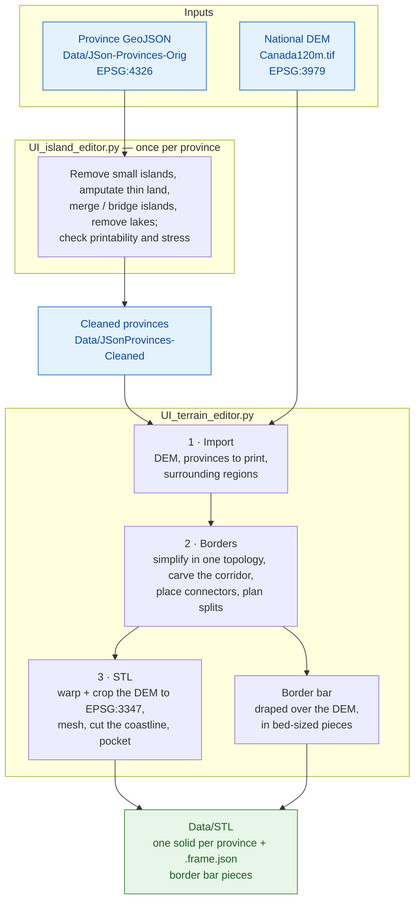

# TerrainPrint

Turn Canadian province boundaries (GeoJSON) and a national elevation model
(GeoTIFF) into STL files that print and fit together as a physical relief map.

The map prints as separate pieces:

- **one terrain solid per province**, with the real elevation on top, cut to the
  coastline;
- **a border bar** that runs along every border between provinces. Dovetail
  connectors on its underside drop into pockets cut into the bottom of the
  province pieces, which holds the map together.

Everything is built at one map scale (1:8,000,000 by default) and every setting
is given in printed millimetres.

## Quick Start

You need Python 3.10. The commands below are for Windows PowerShell, which is
what the project is developed and tested on.

**1. Install**

```powershell
git clone https://github.com/DullemondWilliam/TerrainPrint.git
cd TerrainPrint
py -3.10 -m venv .venv
.\.venv\Scripts\python.exe -m pip install -r requirements.txt
```

**2. Add the elevation model.** The DEM is not in the repository (about 7 GB).
Put it at `Data/Canada120m-Orig/Canada120m.tif`, or a copy already reprojected
to EPSG:3347 at `Data/Canada120m-3347/Canada120m_3347.tif`. The province files
are included, so the island editor works without it.

**3. Run the two editors, in this order**

```powershell
.\.venv\Scripts\python.exe UI_island_editor.py     # clean up a province
.\.venv\Scripts\python.exe UI_terrain_editor.py    # build its STLs
```

The STLs land in `Data/STL`. The **[Usage Guide](docs/USAGE_GUIDE.md)** walks
through the whole workflow step by step.

## Tools

| Tool | What it is for |
|---|---|
| `UI_island_editor.py` | Clean up one province so it can be printed: remove small islands, cut land too thin to print, merge and bridge islands, erase, remove lakes. A side panel marks thin land and necks at risk of breaking. |
| `UI_terrain_editor.py` | The terrain pipeline in three tabs: **Import** the DEM and regions, define the **Borders**, and build the **STL**s, one province at a time or all at once with **Process All**. |
| `ScreenRuler.py` | Optional. Measure your monitor's real pixel size, so the island editor's **Real Size** shows a province at its printed size. |
| `harnesses/` | Developer tools: one small window per library. See [BUILDING_UI_HARNESSES.md](docs/BUILDING_UI_HARNESSES.md). |

## How It Works



Building terrain in QGIS with the DEMto3D plugin is still possible as an
alternative; see [USING_DEMTO3D.md](docs/USING_DEMTO3D.md).

## Documentation

- [Usage Guide](docs/USAGE_GUIDE.md): province files to printable STLs, step by
  step, including [Troubleshooting](docs/USAGE_GUIDE.md#8-troubleshooting). The
  most common problem is `ModuleNotFoundError`, which means the requirements
  are not installed in the venv you are running.
- [Reference](docs/REFERENCE.md): directory structure, settings, file formats,
  coordinate systems and command-line tools.

## Testing

```powershell
.\.venv\Scripts\python.exe -m pytest -q
```

Use pytest, not `unittest`: the Qt UI tests need pytest-qt and `unittest`
silently skips them. The tests use the shipped settings rather than whatever
this computer has saved; see `tests/conftest.py`.

## Data Sources

- Province boundaries: [SimpleMaps](https://simplemaps.com)
- Natural Earth data: [Natural Earth](https://www.naturalearthdata.com)

## License

The code is under the [MIT License](LICENSE). That license does not cover the
files in `Data/`: they remain under their providers' terms.
