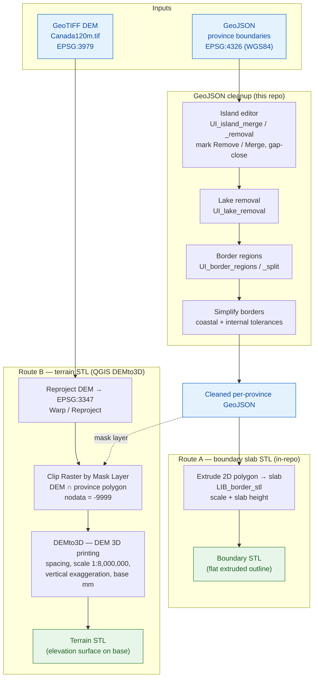

# 3D Terrain Project

Convert Canadian province geospatial data (GeoJSON) into 3D STL models for visualization and analysis.

## Project Overview

This project processes GeoJSON files containing province boundaries and converts them into 3D STL terrain models. It provides tools for:

- Interactively editing individual province GeoJSON files (merging, removing, and gap-closing island parts)
- Previewing and tuning the full processing pipeline before export (island merging, lake removal, border simplification)
- Converting 2D boundary polygons to 3D extruded STL geometries
- Batch processing of multiple province datasets

## Processing Pipeline

There are two routes to STL. The GeoJSON produces the boundary/slab shape, and
the GeoTIFF DEM produces the elevation surface; they meet at the clip/STL stage.



## Directory Structure

```
3D Terrain/
├── Provinces-Orig/                    # Original unmodified province GeoJSON files
├── geojson/                           # Working GeoJSON files (edited per-province)
├── Canada120m/                        # Base geographic data
├── requirements.txt                   # Python dependencies
├── UI_island_editor.py                # Interactive per-file island editor (start here)
├── UI_terrain_editor.py               # National DEM → province STL, the whole pipeline
├── harnesses/                         # One throwaway visual harness per lib (UI_*.py)
├── docs/USING_DEMTO3D.md              # DEM -> STL is now done in QGIS (DEMto3D plugin)
├── lib/                               # Library modules (imported as lib.LIB_*)
│   ├── LIB_border_ledger.py           # Find shared borders; record which are cleaned
│   ├── LIB_seam_fit.py                # Where printed pieces will not mesh; push or solve
│   ├── LIB_border_bar.py              # The border bar in planned pieces: splits, build, colours
│   ├── LIB_border_connectors.py       # Border lobes / solid extrusion / province notching
│   ├── LIB_border_plan.py             # The Borders stage as data: settings, Define, Save / Load
│   ├── LIB_border_regions.py          # Province vs. state border region construction
│   ├── LIB_border_simplification.py   # Topology-aware border simplification
│   ├── LIB_border_split.py            # Bed fit at any turn; auto-split a border STL to the bed
│   ├── LIB_connector_rules.py         # The rules a connector is held to; moving one
│   ├── LIB_border_stl.py              # Extrude a border region to a slab STL
│   ├── LIB_butterfly_keys.py          # Bowtie keys joining two province STLs from the back
│   ├── LIB_print_all.py               # Every province and the border bar to STL in one run
│   ├── LIB_province_joins.py          # Bowtie keys across every border of a map
│   ├── LIB_raster_plan.py             # Plan a crop: its path, its grid, the finest buildable res
│   ├── LIB_island_merging.py          # Merge two islands with a connecting neck of land
│   ├── LIB_island_removal.py          # Small-island detection and removal
│   ├── LIB_lake_removal.py            # Interior ring (lake) removal helper
│   ├── LIB_shape_scores.py            # Score an edited province against the original
│   ├── LIB_stl_reconcile.py           # Recover a printed STL's metres→print-mm frame
│   ├── LIB_terrain_trim.py            # Clip a DEMto3D slab STL to the province coastline
│   └── LIB_thin_features.py           # Find land too narrow to print (necks, spits, islets)
├── ui/                                # Qt widgets shared by more than one window
│   └── seam_editor.py                 # The seam editor (Shared Border harness)
├── tests/                             # All pytest suites (lib + core + app)
└── README.md                          # This file
```

## Installation

```powershell
pip install -r requirements.txt
```

**Key dependencies:** `geopandas`, `shapely`, `pyproj`, `trimesh`, `numpy`, `scipy`, `matplotlib`, `fiona`

---

## Tools

### 1. Island Editor (`UI_island_editor.py`)

Interactive GUI for cleaning up individual province GeoJSON files before running the full pipeline. Open a file, click islands to mark them, then apply changes.

```powershell
py -3 UI_island_editor.py
```

**Sidebar controls:**

| Section | Control | Purpose |
|---|---|---|
| File | Open / Save / Save As | Load and write `.geojson` files |
| Edit | Reset All to Keep | Clear all markings |
| Edit | Apply & Save | Commit merge/remove decisions and write to disk |
| Remove Small Islands | Slider + km² entry | Set a size threshold |
| Remove Small Islands | Mark Small | Mark every part below the threshold as Remove |
| Gap Close | Slider + km entry | Maximum bridging distance |
| Gap Close | Preview | Show dashed purple outline of what gap-close would produce |
| Gap Close | Clear Preview | Remove the overlay |
| Gap Close | Apply Gap Close | Commit the gap-close result |

**Clicking a part on the map** cycles its state and shows its area in the status bar:
- **Keep** (green) — include as-is
- **Remove** (red) — drop entirely on Apply
- **Merge** (orange) — union together with all other Merge parts on Apply, lakes stripped from result

**Gap Close** runs only on Merge-marked parts. It applies a morphological close (`buffer +d/2`, `buffer −d/2`) to fill gaps up to the chosen distance, then lakes are stripped from the result.

---

### 2. Pipeline Preview UI (`UI_simplify_geo_borders.py`)

Three-stage wizard that previews and applies the full processing pipeline across all provinces, then exports STL files.

```powershell
py -3 UI_simplify_geo_borders.py
```

Adjust the coastal and internal tolerances, click **Apply** to preview the simplified borders, then **Export STL** when satisfied.

| Control | Purpose |
|---|---|
| Coastal tolerance | Simplification applied to coastal and international borders |
| Internal tolerance | Simplification applied to shared inter-provincial borders |
| Slab height | Extrusion height used during STL export |

---

### 3. Terrain STL Generator (`UI_terrain_to_stl.py`)

Combines a province GeoJSON boundary with a GeoTIFF DEM to produce a 3D terrain STL.

```powershell
py -3 UI_terrain_to_stl.py
```

| Control | Default | Purpose |
|---|---|---|
| GeoJSON file | — | Province boundary in WGS84 |
| GeoTIFF file | `Canada120m/Canada120m.tif` | Elevation model |
| Terrain ×  | ×10 | Vertical exaggeration factor |
| Scale (1:N) | 1:8 000 000 | Print scale denominator |
| Base (mm) | 2 mm | Flat base thickness below terrain floor |

Click **Preview DEM** to inspect the clipped elevation raster before generating.  Click **Generate STL …** to choose an output path and build the mesh.

---

### 4. GeoTIFF Clipper (`UI_clip_geotiff.py`)

Clip a GeoTIFF raster (DEM, satellite imagery) to province boundaries.

```powershell
py -3 UI_clip_geotiff.py dem.tif geojson/name_Ontario-fixed.geojson output/Ontario_dem.tif
py -3 UI_clip_geotiff.py dem.tif dummy.geojson dummy.tif --info   # inspect metadata only
```

---

### 5. Province Joins harness (`harnesses/UI_province_joins.py`)

Joins every province to its neighbours with butterfly (bowtie) keys pressed
into slots in the back of the printed pieces, and writes the slotted STLs and
the keys to print.

```powershell
py -3 harnesses/UI_province_joins.py
```

**Inputs:** *Provinces …* is the folder of bordered province
GeoJSONs (`Data/JSonProvinces-Bordered`); *STLs …* is the terrain STLs cut from those
same files, each with its `.frame.json` (`Data/STL`). Files pair by name,
ignoring `_simplified` / `_trimmed` / `_keyed`. *Load* finds every border.
Pieces built under other terrain settings, and files that do not pair, are
listed under the borders.

**Key (print-mm):** *Neck*, *Mouth*, *Reach*, *Depth*, *Clearance*, *Spacing*
and *Spares* set one key size for the whole map, so any key fits any slot.
They are saved as you turn them (`keys.*`; *Depth* is `print.dovetail_mm`) and
every key is re-checked at once. A key whose neck is not narrower than its
mouth, or a slot as deep as the terrain base, blocks cutting.

**Placing:** pick a border in the list or click near its seam. *Auto Place*
spaces keys along it (*Auto Place All* along every border); click the seam to
add a key, click a key to remove it, drag a key along the seam. *Undo* / *Redo*
(Ctrl+Z / Ctrl+Y). Borders are grey with no keys, green when every key passes,
amber when some are refused (off the land, into a third province, colliding
with a key on another border, or on land the fit check calls too thin), and
red when an STL on that border was cut from a province that has changed since:
rebuild it in the terrain editor.

**Cut and Save All** writes into the save folder (`Data/STL-Keyed`):
`<province>_keyed.stl` with its frame, `butterfly_keys_01.stl` … (every key
plus the spares, on bed-sized plates), and `join_plan.json`, which reopens the
keys on the next load. *3D* shows the selected border's two pieces cropped
round the seam with the keys in their slots, seen from below, or a key plate.

## Settings

Settings live in two files, merged, local winning:

- `project_config.json` (tracked) holds the project's shipped settings.
- `project_config.local.json` (not tracked) holds what this desk has changed.
  The windows write to it as you turn their controls.

**The libraries never read these files themselves.** Each takes its settings
through its API as a structure (`ThinParams`, `StressParams`, `SeamParams`,
`BridgeParams`, `FitParams`, …) whose defaults are the shipped values, so a
library behaves the same everywhere. Each library also has a
`load_*_params(*config_files, **overrides)` that fills its structure from
config files, later files winning:

```python
from lib.LIB_project_config import settings_files
from lib.LIB_thin_features import load_thin_params, thin_features

params = load_thin_params(*settings_files(), width_mm=0.8)
report = thin_features(province, params)
```

The windows and the command-line tools load their settings this way when they
start, so what you save is what they measure with. The tests use fixed
settings (the shipped ones) rather than whatever this desk has saved; see
`tests/conftest.py`.

## Recommended Workflow

```
Provinces-Orig/          raw source files (never edit these)
       │
       ▼
UI_island_editor.py      open each province, mark small/unwanted islands
       │                 as Remove, mark islands to connect as Merge,
       │                 optionally gap-close, then Apply & Save
       │
       ▼
geojson/                 cleaned per-province files
       │
       ▼
UI_simplify_geo_borders.py  tune merge gap, lake removal, and simplification
       │                 tolerances interactively, then Export STL
       │
       ▼
STL output directory     ready for 3D printing / viewing
```

---

## File Formats

**GeoJSON (input/working)**
- WGS84 (EPSG:4326) coordinates
- `FeatureCollection` containing one `MultiPolygon` feature per province

**STL (output)**
- Binary STL, triangulated mesh of extruded province boundary slab
- One file per province

---

## Coordinate Systems

| Context | CRS |
|---|---|
| GeoJSON files on disk | WGS84 — EPSG:4326 |
| Island editor display & geometry operations | Canadian Lambert — EPSG:3347 |
| STL export | Print-millimetre space (scaled from metres) |

---

## Troubleshooting

**`ModuleNotFoundError`** — run `pip install -r requirements.txt`

**Map doesn't show anything** — confirm the file contains a `MultiPolygon` or `Polygon` geometry in EPSG:4326

**Gap close produces no bridges** — no Merge-marked islands are within the chosen km distance of each other; try increasing the slider or marking more islands as Merge

**STL export fails** — apply Stage 3 (Simplify Borders) before exporting; the Export button is disabled until then

---

## Data Sources

- Province boundaries: [SimpleMaps](https://simplemaps.com)
- Natural Earth data: [Natural Earth](https://www.naturalearthdata.com)

---

**Last Updated:** March 2026
