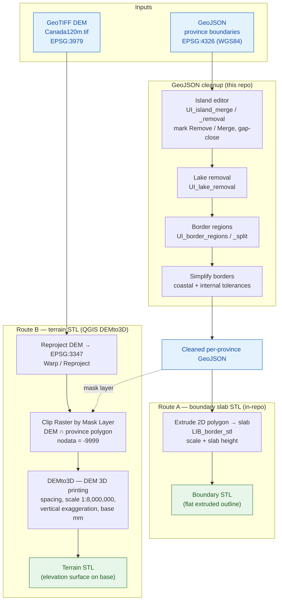

# 3D Terrain Project

Convert Canadian province geospatial data (GeoJSON) into 3D STL models for visualization and analysis.

## Project Overview

This project processes GeoJSON files containing province boundaries and converts them into 3D STL terrain models. It provides tools for:

- Interactively editing individual province GeoJSON files (merging, removing, and gap-closing island parts)
- Previewing and tuning the full processing pipeline before export (island merging, lake removal, border simplification)
- Converting 2D boundary polygons to 3D extruded STL geometries
- Batch processing of multiple province datasets

## Processing Pipeline

There are two routes to STL. The GeoJSON produces the boundary/slab shape, and
the GeoTIFF DEM produces the elevation surface; they meet at the clip/STL stage.



## Directory Structure

```
3D Terrain/
├── Provinces-Orig/                    # Original unmodified province GeoJSON files
├── geojson/                           # Working GeoJSON files (edited per-province)
├── Canada120m/                        # Base geographic data
├── requirements.txt                   # Python dependencies
├── UI_island_editor.py                # Interactive per-file island editor (start here)
├── UI_terrain_editor.py               # National DEM → province STL, the whole pipeline
├── UI_province_viewer.py              # Every province at once, at print size
├── UI_border_editor.py                # Clean every shared border, tracking which are done
├── harnesses/                         # One throwaway visual harness per lib (UI_*.py)
├── docs/USING_DEMTO3D.md              # DEM -> STL is now done in QGIS (DEMto3D plugin)
├── lib/                               # Library modules (imported as lib.LIB_*)
│   ├── LIB_border_ledger.py           # Find shared borders; record which are cleaned
│   ├── LIB_seam_fit.py                # Where printed pieces will not mesh; push or solve
│   ├── LIB_border_connectors.py       # Border lobes / solid extrusion / province notching
│   ├── LIB_border_regions.py          # Province vs. state border region construction
│   ├── LIB_border_simplification.py   # Topology-aware border simplification
│   ├── LIB_border_split.py            # Split a border STL into bed-sized pieces
│   ├── LIB_border_stl.py              # Extrude a border region to a slab STL
│   ├── LIB_dovetail_fitter.py         # Key printed province STLs to the border (dovetails)
│   ├── LIB_island_merging.py          # Merge two islands with a connecting neck of land
│   ├── LIB_island_removal.py          # Small-island detection and removal
│   ├── LIB_lake_removal.py            # Interior ring (lake) removal helper
│   ├── LIB_shape_scores.py            # Score an edited province against the original
│   ├── LIB_stl_reconcile.py           # Recover a printed STL's metres→print-mm frame
│   ├── LIB_terrain_trim.py            # Clip a DEMto3D slab STL to the province coastline
│   └── LIB_thin_features.py           # Find land too narrow to print (necks, spits, islets)
├── tests/                             # All pytest suites (lib + core + app)
└── README.md                          # This file
```

## Installation

```powershell
pip install -r requirements.txt
```

**Key dependencies:** `geopandas`, `shapely`, `pyproj`, `trimesh`, `numpy`, `scipy`, `matplotlib`, `fiona`

---

## Tools

### 1. Island Editor (`UI_island_editor.py`)

Interactive GUI for cleaning up individual province GeoJSON files before running the full pipeline. Open a file, click islands to mark them, then apply changes.

```powershell
py -3 UI_island_editor.py
```

**Sidebar controls:**

| Section | Control | Purpose |
|---|---|---|
| File | Open / Save / Save As | Load and write `.geojson` files |
| Edit | Reset All to Keep | Clear all markings |
| Edit | Apply & Save | Commit merge/remove decisions and write to disk |
| Remove Small Islands | Slider + km² entry | Set a size threshold |
| Remove Small Islands | Mark Small | Mark every part below the threshold as Remove |
| Gap Close | Slider + km entry | Maximum bridging distance |
| Gap Close | Preview | Show dashed purple outline of what gap-close would produce |
| Gap Close | Clear Preview | Remove the overlay |
| Gap Close | Apply Gap Close | Commit the gap-close result |

**Clicking a part on the map** cycles its state and shows its area in the status bar:
- **Keep** (green) — include as-is
- **Remove** (red) — drop entirely on Apply
- **Merge** (orange) — union together with all other Merge parts on Apply, lakes stripped from result

**Gap Close** runs only on Merge-marked parts. It applies a morphological close (`buffer +d/2`, `buffer −d/2`) to fill gaps up to the chosen distance, then lakes are stripped from the result.

---

### 2. Pipeline Preview UI (`UI_simplify_geo_borders.py`)

Three-stage wizard that previews and applies the full processing pipeline across all provinces, then exports STL files.

```powershell
py -3 UI_simplify_geo_borders.py
```

Adjust the coastal and internal tolerances, click **Apply** to preview the simplified borders, then **Export STL** when satisfied.

| Control | Purpose |
|---|---|
| Coastal tolerance | Simplification applied to coastal and international borders |
| Internal tolerance | Simplification applied to shared inter-provincial borders |
| Slab height | Extrusion height used during STL export |

---

### 3. Terrain STL Generator (`UI_terrain_to_stl.py`)

Combines a province GeoJSON boundary with a GeoTIFF DEM to produce a 3D terrain STL.

```powershell
py -3 UI_terrain_to_stl.py
```

| Control | Default | Purpose |
|---|---|---|
| GeoJSON file | — | Province boundary in WGS84 |
| GeoTIFF file | `Canada120m/Canada120m.tif` | Elevation model |
| Terrain ×  | ×10 | Vertical exaggeration factor |
| Scale (1:N) | 1:8 000 000 | Print scale denominator |
| Base (mm) | 2 mm | Flat base thickness below terrain floor |

Click **Preview DEM** to inspect the clipped elevation raster before generating.  Click **Generate STL …** to choose an output path and build the mesh.

---

### 4. GeoTIFF Clipper (`UI_clip_geotiff.py`)

Clip a GeoTIFF raster (DEM, satellite imagery) to province boundaries.

```powershell
py -3 UI_clip_geotiff.py dem.tif geojson/name_Ontario-fixed.geojson output/Ontario_dem.tif
py -3 UI_clip_geotiff.py dem.tif dummy.geojson dummy.tif --info   # inspect metadata only
```

---

### 5. Border Editor (`UI_border_editor.py`)

Cleans the border every pair of neighbouring provinces shares, one at a time,
and keeps track of which are done.

```powershell
py -3 UI_border_editor.py
```

**Borders page:** *Import Folder …* / *Import Files …* loads the provinces and
finds every shared seam. Borders are listed as **Not cleaned** or **Cleaned**,
and drawn red or green on the map. Click two neighbouring provinces (or a border
in a list) and press *Edit Border →* (or double-click the border).

**Edit Border page:** the Shared Border editor (`harnesses/UI_shared_border.py`)
with the same parameters and before/after panels. *Apply and Mark Cleaned*
writes both provinces into the save folder (default
`Data/JSonProvinces-Bordered`, under their own file names) and records the
border in `border_ledger.json` there; *← Borders* goes back without saving.

When a province already has a copy in the save folder, that copy is loaded
instead, so earlier work carries on. A border counts as cleaned only while the
files still carry the seam that was recorded, so a re-exported province puts
its borders back on the Not cleaned list, marked "changed since cleaned".

**Fit check:** every border in the list says whether its printed pieces will
mesh, and the Edit Border page marks the faults on both panels:

| Mark | Fault |
|---|---|
| Red | Land at the seam narrower than *Min width* + 2 × *Edge loss* |
| Amber | A finger (deeper than it is wide) too thin to survive |
| Purple | A tab whose head is wider than its neck: it locks the pieces, so they only go in from above and shrinkage piles up at it |

*Edge loss* is what each printed edge loses per side (over-extrusion,
elephant's foot, clearance; default 0.2 mm). Measure it once on your printer.

**Auto solve:** *Solve Tabs* repairs what the fit check marks, either by
cutting the offending land off (it goes to the other province) or by filling
round it (the other province's undercuts beside a locking tab, or a collar
that brings thin land up to width), whichever leaves fewer problems. It never
moves the border further than *Max move* (default 3 mm) from where it ran, and
leaves anything that would need more for the brush. Moved land is outlined in
green, and the whole solve is one undo step. On Labrador/Québec, simplified,
it takes 33 problems to 6 in about 12 s.

**Push border:** *Grow A* / *Grow B* turn the map into a brush that hands the
land under the stroke to that province, so a locking tab or thin finger can be
pushed back by hand. *Undo* (Ctrl+Z) and *Redo* (Ctrl+Shift+Z or Ctrl+Y)
step through the pushes and solves until another border is opened; Esc leaves
the brush.

## Recommended Workflow

```
Provinces-Orig/          raw source files (never edit these)
       │
       ▼
UI_island_editor.py      open each province, mark small/unwanted islands
       │                 as Remove, mark islands to connect as Merge,
       │                 optionally gap-close, then Apply & Save
       │
       ▼
geojson/                 cleaned per-province files
       │
       ▼
UI_simplify_geo_borders.py  tune merge gap, lake removal, and simplification
       │                 tolerances interactively, then Export STL
       │
       ▼
STL output directory     ready for 3D printing / viewing
```

---

## File Formats

**GeoJSON (input/working)**
- WGS84 (EPSG:4326) coordinates
- `FeatureCollection` containing one `MultiPolygon` feature per province

**STL (output)**
- Binary STL, triangulated mesh of extruded province boundary slab
- One file per province

---

## Coordinate Systems

| Context | CRS |
|---|---|
| GeoJSON files on disk | WGS84 — EPSG:4326 |
| Island editor display & geometry operations | Canadian Lambert — EPSG:3347 |
| STL export | Print-millimetre space (scaled from metres) |

---

## Troubleshooting

**`ModuleNotFoundError`** — run `pip install -r requirements.txt`

**Map doesn't show anything** — confirm the file contains a `MultiPolygon` or `Polygon` geometry in EPSG:4326

**Gap close produces no bridges** — no Merge-marked islands are within the chosen km distance of each other; try increasing the slider or marking more islands as Merge

**STL export fails** — apply Stage 3 (Simplify Borders) before exporting; the Export button is disabled until then

---

## Data Sources

- Province boundaries: [SimpleMaps](https://simplemaps.com)
- Natural Earth data: [Natural Earth](https://www.naturalearthdata.com)

---

**Last Updated:** March 2026
